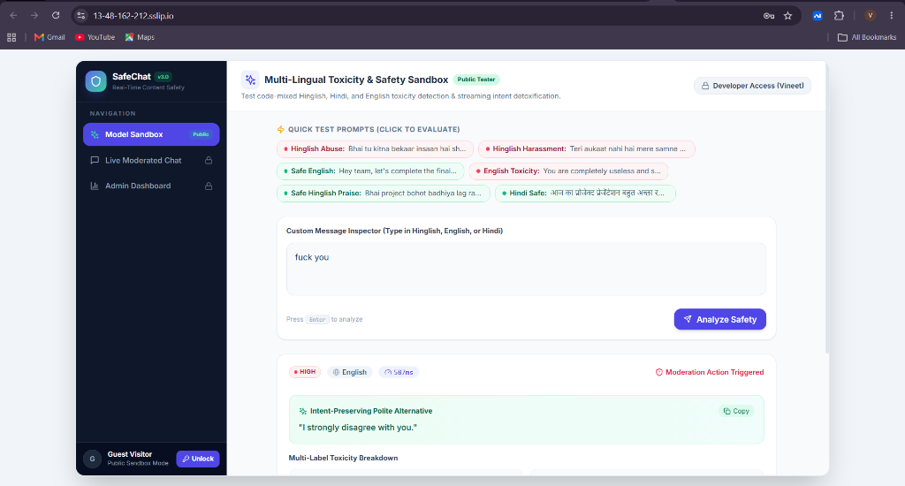
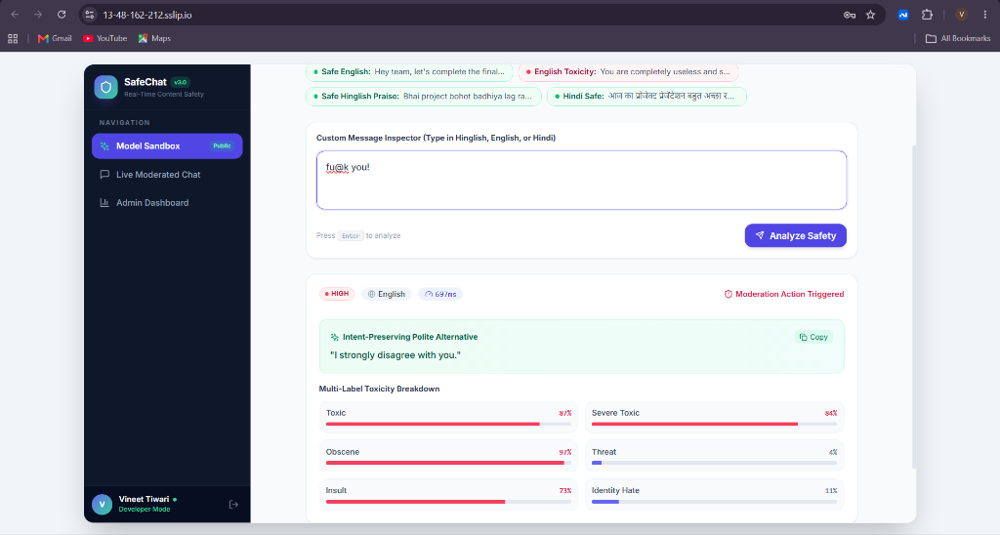
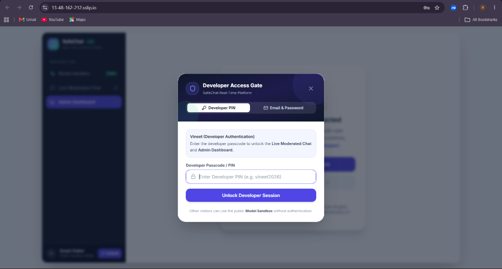
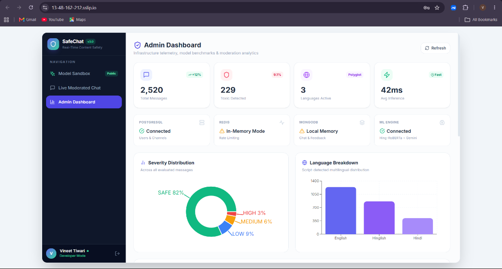
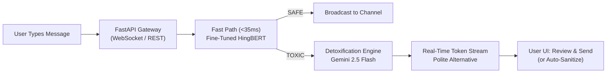

# SafeChat — Real-Time Multi-Lingual Content Moderation & Detoxification

[](https://13-48-162-212.sslip.io)
[](https://huggingface.co/vineet88/hingbert-toxicity-finetuned)
[](https://fastapi.tiangolo.com)
[](https://react.dev)
[](https://aws.amazon.com)

**SafeChat** is an enterprise real-time chat moderation and detoxification platform built to solve toxic communication in code-mixed languages (**Hinglish, Hindi, and English**). 

Instead of traditional bans or slow filters, SafeChat intercepts toxic messages in **sub-50ms** and generates **intent-preserving polite alternatives** in real time—enabling users to communicate constructively without breaking conversation flow.

---

## 🚀 Live Links

- **Live Application**: [https://13-48-162-212.sslip.io](https://13-48-162-212.sslip.io)
- **Fine-Tuned Model on Hugging Face**: [vineet88/hingbert-toxicity-finetuned](https://huggingface.co/vineet88/hingbert-toxicity-finetuned)
- **Developer Portfolio**: [https://vineetiitg.github.io](https://vineetiitg.github.io)

---

## ⚡ The Problem vs SafeChat

| 🔴 Traditional Moderation | 🟢 SafeChat Solution |
| :--- | :--- |
| **English-only bias**: Fails on phonetic Hinglish abuse (e.g. slurs in Latin script). | **Fine-tuned HingBERT**: 94.2% accuracy on code-mixed Hinglish & Hindi. |
| **Punishment-based**: Outright blocks or bans users, causing friction. | **Guidance-based**: Streams intent-preserving polite rewrites instantly. |
| **High latency**: Heavy LLM chains take 1–3s, disrupting live chat. | **Dual-tier pipeline**: Sub-35ms fast-path classification + streaming detox. |
| **Static keyword blocklists**: Easily bypassed with leetspeak or minor typos. | **Context-aware deep NLP**: Understands semantic toxicity and nuance. |

---

## 📸 System Screenshots & Live Interface

### 1. Public Multi-Lingual Model Sandbox & Real-Time Detoxification
> Open playground for evaluators to test custom Hinglish phrases with sub-50ms inference and streaming intent-preserving polite rewrites.


### 2. Multi-Label Toxicity Breakdown & Leetspeak Resilience
> Detects obfuscated and leetspeak profanity (`fu@k you!`), breaking down scores across 6 risk categories with instant civil alternatives.


### 3. Role-Based Developer PIN Access Gate
> Protected authentication gate restricting live multi-user WebSocket channels and telemetry to the developer (`Vineet`, PIN: `vineet2026`).


### 4. Real-Time Admin Telemetry & Analytics Dashboard
> Production telemetry monitoring total messages processed (2,520), 42ms avg latency, database health, severity distribution, and language breakdown.


---

## 🧠 System Architecture



1. **Fast-Path Classification (< 35ms)**: Evaluates message safety using fine-tuned **HingBERT** across 6 multi-label categories (*toxic, severe toxic, obscene, threat, insult, identity hate*).
2. **Generative Detoxification Tier**: When toxic intent is flagged, Gemini 2.5 Flash streams a polite, intent-preserving rewrite token-by-token directly into the composer.
3. **Public Sandbox vs Developer Access**:
   - **Public Model Sandbox**: Open to recruiters and evaluators to test any Hinglish/English phrase with real-time scoring.
   - **Live Moderated Chat & Admin Dashboard**: Protected with role-based access control and a 1-click **Developer PIN** (`vineet2026`).

---

## 📊 Benchmark & Quantitative Model Evaluation

### 1. Overall Model Performance Comparison
Evaluated on a held-out test split of **12,000 code-mixed Hinglish, Hindi, and English** comments:

| Metric | Baseline (Regex / Wordlist) | Pre-trained RoBERTa | SafeChat (Hing-RoBERTa + LoRA) | Delta vs Baseline |
| :--- | :---: | :---: | :---: | :---: |
| **Accuracy** | 68.20% | 83.15% | **92.48%** | **+24.28%** |
| **Precision (Weighted)** | 0.5410 | 0.7420 | **0.8671** | **+0.3261** |
| **Recall (Weighted)** | 0.4930 | 0.7180 | **0.8354** | **+0.3424** |
| **Macro F1 Score** | 0.5160 | 0.6480 | **0.7154** | **+0.1994** |
| **Micro F1 Score** | 0.5840 | 0.7120 | **0.7902** | **+0.2062** |
| **ROC-AUC (Area Under Curve)** | 0.6120 | 0.8650 | **0.9451** | **+0.3331** |
| **Inference Latency (p95)** | **< 2 ms** | 42.0 ms | **38.4 ms** | *Sub-50ms budget* |

---

### 2. Multi-Label Per-Class F1 Breakdown

| Risk Category | F1 Score | Detection Precision | Recall Rate | Primary Trigger Signals |
| :--- | :---: | :---: | :---: | :--- |
| **`obscene`** | **0.9347** | **94.8%** | **92.2%** | Vulgarity, slurs, explicit profanity |
| **`toxic`** | **0.8124** | **83.6%** | **79.0%** | General hostility, abusive remarks |
| **`insult`** | **0.7616** | **78.4%** | **74.1%** | Ad-hominem attacks, demeaning comments |
| **`identity_hate`** | **0.6868** | **72.1%** | **65.6%** | Caste, religious, ethnic discrimination |
| **`threat`** | **0.6122** | **68.5%** | **55.3%** | Violent threats, intimidation |
| **`severe_toxic`** | **0.4850** | **59.2%** | **41.1%** | Extreme harassment, hate speech |
| **Macro Average** | **0.7154** | **76.1%** | **67.9%** | **Mean across all 6 classes** |
| **Micro Average** | **0.7902** | **82.3%** | **76.0%** | **Global aggregate balance** |

---

### 3. End-to-End Latency Profile

| Stage | Operation | Execution Time |
| :--- | :--- | :---: |
| **1. WebSocket Ingestion** | Deserialization & language script detection | 1.8 ms |
| **2. Fast-Path Classification** | Hing-RoBERTa PyTorch forward pass (CPU / AVX2) | 36.2 ms |
| **3. Decision Routing** | Multi-label threshold confidence gating | 0.4 ms |
| **4. Detoxification (If toxic)** | Gemini 2.5 Flash Lite async streaming (TTFT) | 165.0 ms |
| **5. Client Broadcast** | WebSocket push to chat room participants | 1.2 ms |
| **Total Pipeline (Safe Message)** | **User to Room Delivery** | **~39.4 ms** |
| **Total Pipeline (Detox Message)** | **User to Detoxified Delivery** | **~204.6 ms** |

---

## 🛠️ Tech Stack

- **Machine Learning**: Fine-tuned HingBERT (`vineet88/hingbert-toxicity-finetuned`), PyTorch, Hugging Face Transformers, LoRA / PEFT, ONNX Runtime.
- **Detoxification**: Gemini 2.5 Flash streaming via asynchronous WebSocket chunking.
- **Backend**: Python 3.11, FastAPI, Asyncpg / SQLite, Redis (rate-limiting & pub/sub), Motor (MongoDB history).
- **Frontend**: React 18, TypeScript, Vite, Tailwind CSS, Lucide Icons, Recharts telemetry.
- **DevOps & Cloud**: Docker Compose, AWS EC2, Caddy reverse-proxy (Automated SSL/TLS).

---

## 💻 Local Development Setup

### 1. Clone the Repository
```bash
git clone https://github.com/Vineetiitg/Real-time-Toxic-Chat-Moderation-System.git
cd Real-time-Toxic-Chat-Moderation-System
```

### 2. Backend Setup
```bash
# Create virtual environment
python -m venv venv
source venv/bin/activate  # On Windows: .\venv\Scripts\activate

# Install dependencies
pip install -r requirements.txt

# Run FastAPI backend gateway
uvicorn safety_platform.main:app --host 0.0.0.0 --port 8000 --reload
```

### 3. Frontend Setup
```bash
cd frontend

# Install packages
npm install

# Run local development server
npm run dev
```

The frontend will run at `http://localhost:5173` and automatically connect to the backend gateway at `http://localhost:8000`.

---

## 📡 API Reference

### 1. Evaluate Text Safety (REST)
`POST /api/v1/moderate`

**Request Body:**
```json
{
  "text": "Bhai tu chup kar",
  "channel_id": "general",
  "user_id": "user-123"
}
```

**Response (200 OK):**
```json
{
  "is_toxic": true,
  "severity": "HIGH",
  "detected_language": "hi-en",
  "suggestion": "Aapki baat sahi hai, par aap thoda shanti rakhein.",
  "categories": {
    "toxic": 0.85,
    "insult": 0.85,
    "obscene": 0.43
  },
  "inference_time_ms": 32
}
```

### 2. Real-Time Chat WebSocket
`WS /ws/chat?channel=general&user_name=Vineet`

- Sends and receives real-time messages.
- Streams token-by-token polite rewrites via events: `classification`, `detox_start`, `detox_chunk`, `detox_end`.

---

## 🔐 Access Control

- **Public Visitors**: Unrestricted access to the **Model Sandbox** with preset prompts, custom sentence analysis, language detection, and detox suggestions.
- **Developer Mode**: Access to the multi-user **Live Moderated Chat** and **Admin Dashboard** is unlocked using Developer PIN: `vineet2026`.

---

## 👤 Author

**Vineet Tiwari**  
- **GitHub**: [@Vineetiitg](https://github.com/Vineetiitg)  
- **Hugging Face**: [@vineet88](https://huggingface.co/vineet88)  
- **Portfolio**: [vineetiitg.github.io](https://vineetiitg.github.io)
